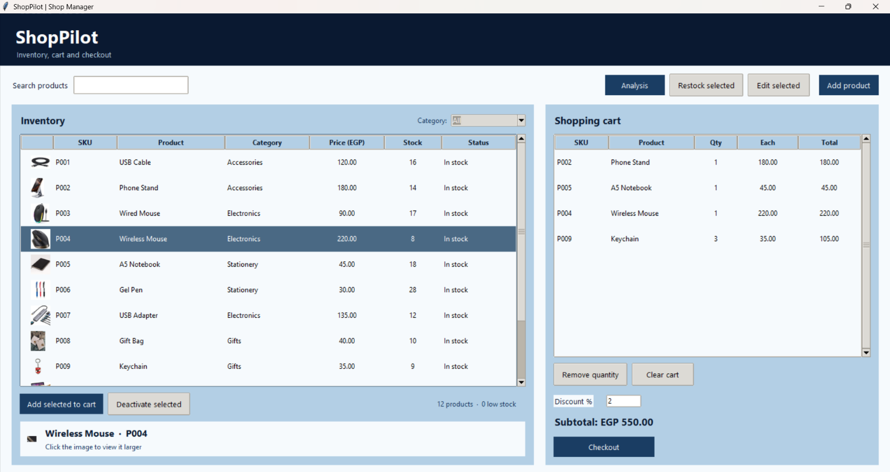
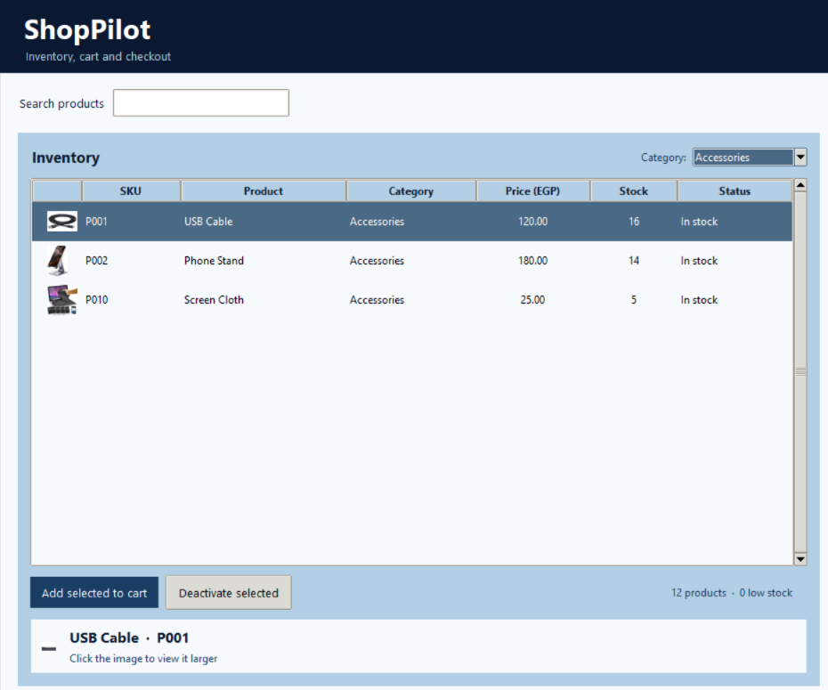
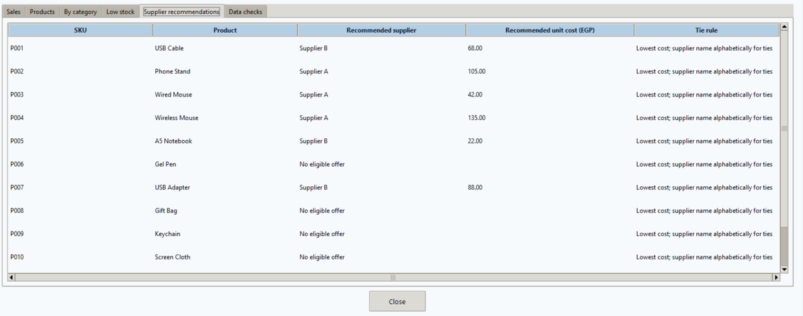
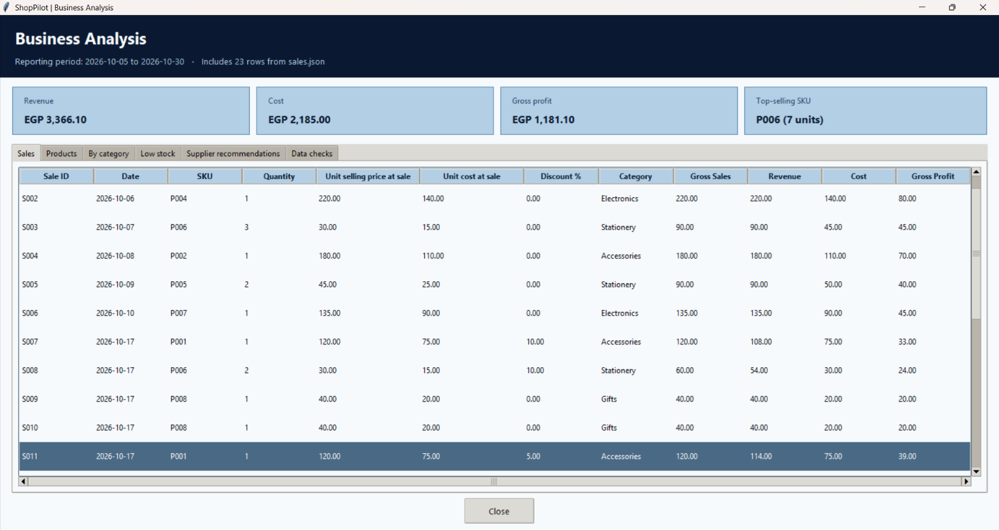
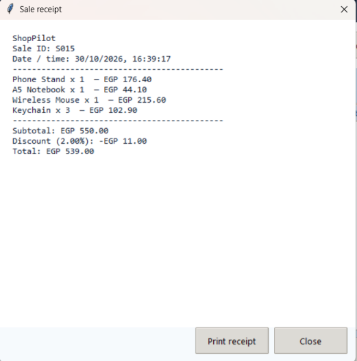

# ShopPilot

> A desktop shop manager for product inventory, cart checkout, sales history, and business analysis.

ShopPilot is a Python desktop application built with Tkinter. It keeps its working data in local JSON files and provides a simple interface for managing products, checking stock, recording sales, and reviewing reports.

## Screenshots

Screenshots below show the main workflow and analysis screens.

| Main window | Inventory and category filter |
|---|---|
|  |  |
| Browse inventory and work with the shopping cart. | Choose a category or select **All** to show every product. |

| Supplier recommendations | Sales analysis |
|---|---|
|  |  |
| Compare eligible supplier offers by SKU. | Review sales, stock, and business metrics. |

### Sale receipt

<p align="center">
  
</p>

## Features

- Browse products in an inventory table and search by SKU or product name.
- Filter inventory by category or select **All** to show every product.
- Add, edit, restock, and deactivate products.
- Show low-stock and out-of-stock products with highlighted rows.
- Attach a product photo, preview it, and open a larger view.
- Add products to a cart, change cart quantities, and apply a checkout discount.
- Validate product quantities against available stock before completing a sale.
- Create sequential sale IDs and save sale lines and updated inventory locally.
- Open a password-protected analysis screen with sales, category, stock, and supplier reports.
- Export analysis results to CSV and Excel files in `reports/`.

## Requirements

- Python 3.10 or newer
- Tkinter (usually included with the standard Python installer on Windows)
- Packages listed in `requirements.txt`

The project uses Pillow for product images, Pandas for analysis, openpyxl for Excel files, and requests for the API exercise dependency.

## Run the application

Open PowerShell in the project folder and run:

```powershell
py -m venv .venv
.\.venv\Scripts\Activate.ps1
python -m pip install --upgrade pip
python -m pip install -r requirements.txt
python main.py
```

Run `main.py` from the project root. It is the application entry point and launches the ShopPilot interface.

## Using the application

1. Search for a product or select a category in the inventory panel.
2. Select a product to view its photo and details.
3. Use **Add product**, **Edit selected**, or **Restock selected** to manage inventory.
4. Add products to the cart and set a discount percentage if needed.
5. Select **Checkout** to record the sale, update stock, and display the receipt.
6. Select **Analysis** and enter the current demo password `1234` to open the reports screen.

To add a product photo, choose an image in the product form. ShopPilot copies it into `product_photo/` and saves its filename with the product record.

## Project structure

```text
Shop_Pilot/
├── main.py                       # Application entry point
├── ShopPilot_UI.py               # Tkinter interface and user interactions
├── ShopPilot_system.py           # Product, cart, order, and shop rules
├── ShopPilot_analysis.py         # Pandas analysis and report exports
├── requirements.txt              # Python package dependencies
├── data/
│   ├── products.json             # Current inventory
│   ├── sales.json                # Historical and new sale lines
│   ├── Supplier_A.json           # Supplier A training data
│   ├── supplier_b.html           # Supplier B source catalog
│   └── supplier_b_extracted.csv  # Supplier B offers used by analysis
├── product_photo/                # Product images
├── reports/                      # Generated CSV and Excel reports
└── docs/
    └── images/                   # Add README screenshots here
```

## How the application is organized

```text
main.py
  └── ShopPilot_UI.py  ── calls business rules in ──> ShopPilot_system.py
          └── Analysis button ── calls ──> ShopPilot_analysis.py

ShopPilot_UI.py reads and saves data under data/ and displays product_photo/.
ShopPilot_analysis.py writes generated reports under reports/.
```

- **`main.py`** starts the desktop application.
- **`ShopPilot_UI.py`** builds the windows, tables, forms, category filter, image previews, dialogs, and receipt screen.
- **`ShopPilot_system.py`** contains the product, cart, order, stock validation, checkout, receipt formatting, and inventory file logic.
- **`ShopPilot_analysis.py`** prepares sales and product DataFrames, calculates metrics, cleans a separate sample copy, compares eligible supplier offers, and exports reports.
- **`data/`** contains the local inventory, sales history, and supplier fixtures.
- **`product_photo/`** contains image files referenced by product records.
- **`reports/`** contains generated analysis outputs. The analysis screen can regenerate these files.

## Data and report files

- `data/products.json` is the current inventory. Product edits and stock changes are saved here.
- `data/sales.json` stores one record per product line sold, including the sale ID, date, quantity, sale-time selling price, sale-time cost, and discount.
- Analysis outputs are written to `reports/`, including sales, category, low-stock, supplier recommendation, and cleaned-data CSV reports, plus an Excel round-trip workbook.

The data is stored locally as JSON and CSV; this project does not use a database or cloud synchronization. Keep a backup of important data files.

## Notes

- The analysis password `1234` is hard-coded for this educational project. It is only a basic screen prompt and is not secure authentication.
- The **Print receipt** button is a placeholder; printer integration is not configured.
- Supplier and product data are local project fixtures. Review them before using the project with real business records.
- Do not commit real customer information, private sales data, passwords, or API keys to a public repository.

## License

No license is currently specified. Add a license file if you want to define how others may use or modify this project.
